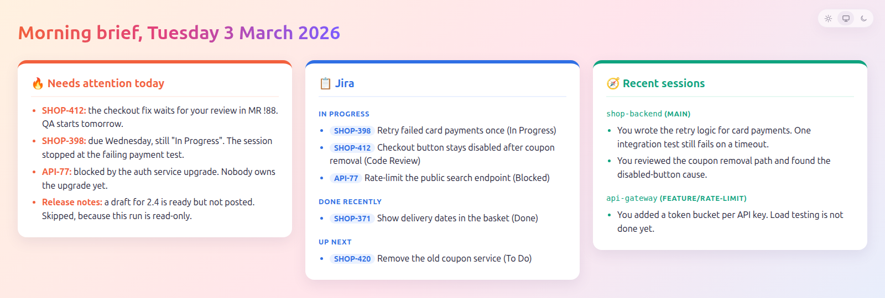
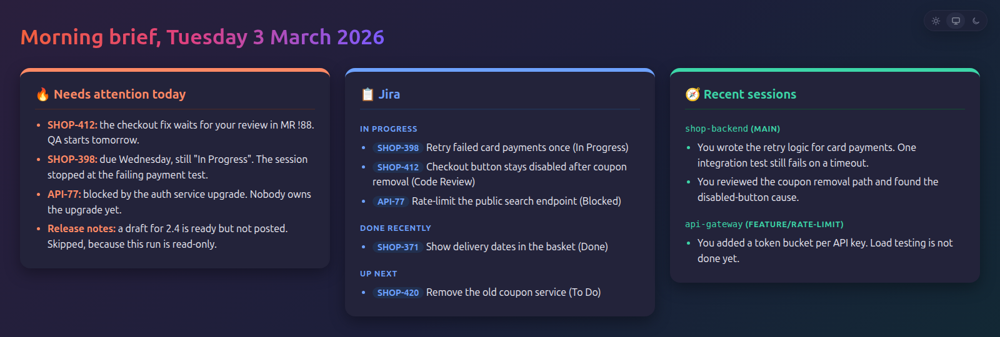

# morning-wood

A morning brief for developers who work with Claude Code and Jira.

Every weekday, at a time you choose, morning-wood:

1. Reads your Claude Code sessions from the last 3 workdays.
2. Asks Claude to look up your Jira issues and write a short brief.
3. Saves the brief as an HTML page.
4. Shows a desktop notification. Click it to open the brief in your browser.

The brief has three tiles: **Needs attention today**, **Jira**, and **Recent sessions**.
It has a light, a dark and an automatic theme.



<details>
<summary>Dark theme</summary>



</details>

## Prerequisites

You need all of these:

| What | Why | How to check |
|---|---|---|
| **Claude Code CLI**, logged in | It writes the brief. Tested with 2.1.310. | `claude --version` |
| **A Jira MCP server in Claude Code**, logged in | Claude reads your Jira issues through it. | `claude mcp list` shows it as connected |
| **Python 3.11 or later** | Runs the script. No extra packages. | `python3 --version` |
| **pandoc** | Turns the brief into HTML. | `pandoc --version` |

Platform parts:

| Platform | Needs | Status |
|---|---|---|
| Linux | A systemd user session, `notify-send` (libnotify 0.7.9 or later for click-to-open), a browser | Tested on Ubuntu 24.04 with GNOME |
| macOS | Nothing extra. Optional: `brew install terminal-notifier`, so a click on the notification opens the brief | **Not tested yet.** Reports are welcome. |
| Windows | – | Not supported |

### Set up the Jira MCP server

If `claude mcp list` does not show a Jira server yet, add Atlassian's remote server for your user:

```sh
claude mcp add --transport http --scope user atlassian https://mcp.atlassian.com/v1/mcp
```

Then start `claude`, type `/mcp`, select `atlassian` and log in.

If you already use Atlassian through a claude.ai connector, you can use that one instead.
Put its name, as `claude mcp list` shows it, in the config (see below).

Each brief is one Claude run. It uses your Claude plan or your API credits.

## Install

```sh
git clone https://github.com/maclav3/morning-wood.git
cd morning-wood
python3 morning_wood.py check            # checks the prerequisites
python3 morning_wood.py run --open       # writes today's brief and opens it
python3 morning_wood.py install --time 07:37
```

`install` runs the brief every weekday at that local time.
The default time is 07:37, because many scheduled jobs start at 08:00.
It uses a systemd user timer on Linux and a launchd agent on macOS.
If the computer is asleep at that time, the brief runs when it wakes up.

The schedule runs the script from the folder you cloned. Do not move that folder after `install`.
If you move it, run `install` again.

## Commands

| Command | What it does |
|---|---|
| `run` | Writes today's brief and shows a notification. `--open` opens the brief at once. `--no-notify` only prints its path. |
| `check` | Checks the prerequisites and the MCP server. |
| `prompt` | Prints the full prompt, with the session digest, without sending it. Use it to see what Claude gets. |
| `install --time HH:MM` | Runs the brief every weekday. |
| `uninstall` | Removes the schedule. Your config and your briefs stay. |

## Configuration

The config file is optional: `~/.config/morning-wood/config.toml`.
`install` writes one from [`config.example.toml`](config.example.toml) if none exists.

| Key | Default | Meaning |
|---|---|---|
| `mcp_server` | `"atlassian"` | Name of your Jira MCP server, as `claude mcp list` shows it |
| `workdir` | your home folder | Folder that Claude runs in. Set it to a project folder if your MCP server has project or local scope. |
| `jira_tools` | the read tools of Atlassian's server | Read-only tools Claude may call. Change it if you use another Jira server. |
| `output_dir` | `"~/briefs"` | Where the `.md` and `.html` briefs go |
| `workdays_back` | `3` | How many workdays of sessions go into the brief |
| `model` | your Claude Code default | Claude model, for example `"sonnet"` |

The brief opens in your default browser: with `open` on macOS, and `sensible-browser` or `xdg-open` on Linux.

### Change the brief

To change what the brief contains, copy [`prompt.md`](prompt.md) to `~/.config/morning-wood/prompt.md` and edit it.
The tile colours belong to the three section headings.
If you rename a heading, its tile turns blue.

## How it stays read-only

The brief must never change anything. Ticket text could also contain instructions aimed at Claude.
So morning-wood limits Claude with flags, not only with words in the prompt:

- `--tools ""`: Claude has no built-in tools. It cannot read files, write files or run commands.
- `--permission-mode dontAsk` and `--allowedTools`: Claude may call only the Jira read tools in `jira_tools`. The flag replaces the default mode from your settings, for example `auto`.
- `--no-session-persistence`: the run leaves no session behind, so the next brief does not read it.

The script, not Claude, reads your session transcripts. It sends Claude a short digest of them.

The HTML page also protects itself:

- Raw HTML and `{…}` attributes in Claude's output appear as text.
- Only `http` and `https` links stay clickable.
- A Content Security Policy lets only the theme script run, and the page loads nothing from the network.

`tests/test_morning_wood.py` checks these rules against hostile Markdown.

## What leaves your computer

- The session digest goes to Claude: the last prompts and replies of each recent session, cut short.
- Claude sends your Jira queries to your Jira server through the MCP server.
- Run `python3 morning_wood.py prompt` to see exactly what is sent.

## Troubleshooting

| Problem | What to do |
|---|---|
| A "Morning brief failed" notification | Linux: `journalctl --user -u morning-wood`. macOS: `~/Library/Logs/morning-wood.log`. |
| The Jira tile is empty or says it cannot reach Jira | Run `check`. Then run `claude` in `workdir`, type `/mcp` and log in again. |
| No notification on Linux | Check that `notify-send hello` works in your desktop session. The click action needs libnotify 0.7.9 or later. With an older version, `notify-send` fails and the brief is only written to `output_dir`. |
| The notification does not open the brief on macOS | Install `terminal-notifier`. |
| Nothing ran at the scheduled time | Linux: `systemctl --user list-timers morning-wood.timer`. macOS: `launchctl print gui/$(id -u)/local.morning-wood`. |
| It failed right after the computer woke up | The network was not up yet. Run it again: `systemctl --user start morning-wood` (Linux) or `launchctl kickstart gui/$(id -u)/local.morning-wood` (macOS). |

The session digest reads Claude Code's transcript files. Their format is internal to Claude Code and can change.
If the **Recent sessions** tile goes empty after a Claude Code update, please open an issue.

## Development

```sh
python3 -m unittest discover tests
```

The render tests need pandoc. The other tests need nothing.

## Licence

[MIT](LICENSE)
